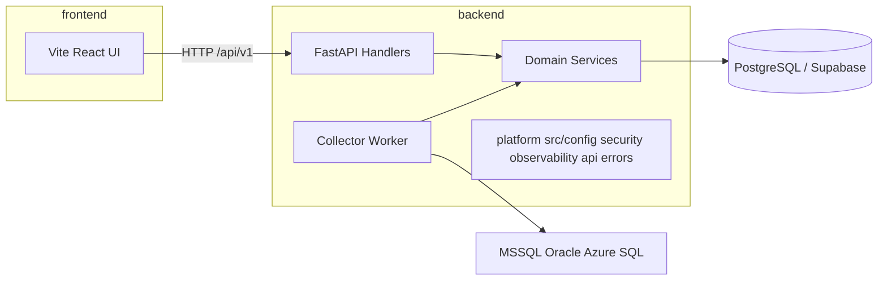

# dbmonitoring 전면 재개발·리팩토링 계획 (초안)

| 항목 | 내용 |
|------|------|
| 문서 상태 | **초안 (Draft)** — 검토·수정 반복 예정 |
| 작성 기준일 | 2026-05-26 (KST) |
| 참조 가이드 | [AI_PLATFORM_DEV_GUIDE.md](./AI_PLATFORM_DEV_GUIDE.md), [DEPLOYMENT_PROMPT.md](./DEPLOYMENT_PROMPT.md) |
| 도메인 기준 | [PRD.md](./PRD.md), [development-plan.md](./development-plan.md) |
| 문서 목적 | (1) **개발 목적 재확인** 후 (2) **기술 재구축(원 계획대로)** 을 수행하기 위한 실행 계획·체크리스트 |

---

## 변경 이력

| 버전 | 일자 | 변경 요약 | 작성 |
|------|------|-----------|------|
| 0.1 | 2026-05-26 | 초안 작성 | AGENT |
| 0.2 | 2026-05-26 | §1 비즈니스·운영 목적 개요 보강 (통합 DB 관제 관점) | AGENT |
| 0.3 | 2026-05-26 | Phase P0(목적 재확인) 선행·기술 R0~R6 유지 명시 | AGENT |
| 0.4 | 2026-05-26 | 상시 관제·즉각 인지(루틴 점검 비전제) — SYSTEM_PURPOSE 반영 | AGENT |
| 0.5 | 2026-05-26 | P0: 화면 인지만·수집/UI 60초 (§5.1) | USER+AGENT |
| 0.6 | 2026-05-26 | R0 골격: frontend/backend, OpenAPI, Rules, 레거시 프록시 | AGENT |
| 0.7 | 2026-05-26 | R1 1차: 읽기 API 5종 네이티브 (MSSQL/Supabase/메모리) | AGENT |
| 0.8 | 2026-11-26 | R1~R3 네이티브 확장, Vite 포털 라우팅, R6 스켈레톤 | AGENT |

---

## 0. 전체 진행 순서 (의도)

리팩토링은 **두 층**으로 나눈다. **기술 스택·이관 범위(R0~R6)는 v0.1 계획을 변경하지 않는다.**  
**그 전에** “이 시스템을 왜 만드는가”를 문서·범위 기준으로 다시 맞춘 뒤 기술 재구축에 들어간다.

```text
Phase P0  개발 목적·관제 포지셔닝 재확인  ──게이트──▶  Phase R0~R5  기술 재구축 (원 계획)
                                                      Phase R6      배포 (VM 후)
```

| 순서 | 단계 | 무엇을 하나 | 기술 재구축과의 관계 |
|------|------|-------------|----------------------|
| **먼저** | **P0** | PRD·운영 시나리오·우선순위 **재정렬·확정** | R0 착수 **전** 필수 |
| **이후** | **R0~R5** | frontend/backend 이관, OpenAPI, Worker, UI parity | **변경 없음** (본 문서 v0.1 로드맵) |
| **나중** | **R6** | Harbor/Fleet 등 | VM 이후, **보류 유지** |

**P0에서 하지 않는 것**: 프레임워크 선정 변경, `gitops/` 생성, 대규모 코드 이관 — **R0 이후**만 수행.

---

## 1. 배경 및 목표

> **한 줄 정의**: 여러 업무 시스템의 데이터베이스를 **한곳에서 상시 관제**하여, 장애 없는 **운영 연속성**을 확보하고, 기능 개발·변경 업무와 **병행 가능한** 안정적인 DB 운영 기반을 만드는 **통합 데이터베이스 관제 플랫폼**이다.

### 1.1 시스템 개발 배경 (추진 동기)

여러 시스템의 운영을 담당하는 입장에서는 다음이 **동시에** 요구된다.

| 구분 | 현실 업무 | DB 관제가 막아야 하는 리스크 |
|------|-----------|------------------------------|
| **애플리케이션** | 시스템별 화면·로직 개발·수정, 배포, 요구사항 대응 | 개발·배포 과정에서 DB 부하·잠금·성능 저하가 누적되어도 **조기 인지 불가** |
| **인프라·데이터** | DB 연결·백업·용량·패치, 이기종 DBMS 혼재 | **도구·화면이 DBMS·시스템마다 분산**되어 “지금 전체적으로 안전한가?”에 답하기 어려움 |
| **운영 연속성** | 서비스 중단 최소화, 장애 시 빠른 원인 추적 | 징후(Blocking, Wait, CPU, Long Query, Deadlock)를 **상시** 보지 못하면 **사전 예방·연속 운영**이 어려움 |

그 결과로 실무에서 반복되는 문제는 [PRD.md](./PRD.md) §1.3과 맞닿아 있다.

- DBMS별 관리 도구·관측 경로 분산
- 장애 **징후**를 일상적으로 보기 어려움 (장애 **후** 대응에 치우침)
- SQL·실행 계획·성능 이력이 시스템 단위로 흩어짐
- 알림·이슈 대응 절차 비표준화

**본 프로젝트의 출발점**은 “성능 분석 툴만 하나 더”가 아니라, **담당 시스템 전반의 DB 상태를 업무 시스템 단위로 묶어 상시 모니터링하고, 이상 징후를 조기에 알려 운영 연속성을 지키는 관제 허브**를 두는 것이다.

### 1.2 시스템 목적 (운영·관제 관점)

| 목적 | 설명 | 제품에서의 주요 수단 (현재·TO-BE 공통) |
|------|------|----------------------------------------|
| **통합 관제** | MSSQL·Oracle·Azure SQL 등 이기종 DB를 **한 포털**에서 조회 | 통합 대시보드, 업무 시스템·DB 인스턴스 마스터, DBMS별 상태 |
| **상시 모니터링** | “지금”과 “최근 추이”를 놓치지 않음 | 실시간 지표·세션·Wait·Blocking·Deadlock, 주기 Collector |
| **장애 예방·연속성** | 서비스 중단 전 조치·우선순위 판단 | 임계치·이벤트 알림, Top SQL·회귀·Plan 변경 분석 |
| **표준화된 대응** | 담당자·역할이 달라도 같은 화면·같은 지표 언어 | 공통 UI/메뉴, (후속) 이슈·리포트·RBAC |
| **개발·운영 병행** | 화면/로직 개발에 치중하는 동안에도 DB 안정성 **별도 라인**으로 유지 | 자동 수집·알림으로 “매일 SSMS만 돌리는” 부담 감소 |

**성공 상태 (의도한 최종 모습)**  
아침·퇴근 등 **고정 점검 루틴 없이**, 상시 수집·화면·알림으로 **사용자 장애로 이어질 DB 징후**(부하 임계 초과, Lock·Blocking, Wait·Deadlock, 장시간 세션·쿼리 등)를 운영자가 **즉각 인지**하고, 같은 포털에서 원인 후보를 좁힐 수 있는 것.

### 1.3 제품 개념 정리

| 용어 | 의미 |
|------|------|
| **업무 시스템** | ERP, 그룹웨어 등 **서비스 단위** (DB 인스턴스와 매핑) |
| **DB 인스턴스** | 실제 모니터링·수집 대상 DB (호스트·DBMS·수집 주기) |
| **관제** | 지표·세션·SQL·알림을 **주기·실시간**으로 수집·표시·경보 |
| **운영 연속성** | 계획된 변경과 예기치 않은 부하 모두에서 **가용성·성능 저하 시간 최소화** |

PRD의 “통합 DB 모니터링 및 **성능 분석**”은 위 목적의 하위 수단이다. **1차 가치는 관제·연속성**, 성능 분석·튜닝·(후속) AI는 **원인 규명·개선** 단계에서 강화한다.

### 1.4 PRD·문서와의 정합성 점검

| 항목 | [PRD.md](./PRD.md) | 본 개요(0.2) | 비고 |
|------|---------------------|--------------|------|
| 이기종 DB 통합 | §1.2, §1.4 | ○ | 일치 |
| 장애 예방·실시간 탐지 | §1.4 | ○ “상시 모니터링·연속성”으로 강조 | 표현 보강 |
| 다수 시스템 운영 담당·개발 병행 | (명시 약함) | ○ §1.1에 반영 | **PRD §1.3 추진 배경에 한 줄 추가 권장** |
| “통합 DB **관제**” 포지셔닝 | “모니터링·성능 분석” 중심 | ○ 관제 허브로 정의 | README 한 줄 보강 권장 |
| 업무 시스템별 현황 | FR-001, 화면 Out of Scope 일부 | ○ §6.1 SCR-04 미구현 | 관제 목적상 **우선순위 재검토 가능** |

**재개발(TO-BE) 시 불변 원칙**: 기술 스택이 바뀌어도 §1.2의 **운영·관제 목적**과 수집→저장→알림→화면 파이프라인은 **동등 이상**으로 유지한다 (이관 매트릭스 §6).

### 1.5 재개발(기술) 배경

- 현재 `dbmonitoring`은 **Next.js 16 App Router** 기반 풀스택 애플리케이션으로, UI·REST API·Collector·저장·알림이 단일 레포에 결합되어 있습니다.
- 조직 표준은 **모노레포 `frontend/` + `backend/` + (추후) `gitops/`**, 프론트 **Vite 5 · React 18 · TypeScript 5 · Tailwind**, 백엔드 **Python(FastAPI)** 및 AI 플랫폼 인프라 레이어입니다.
- **재개발의 이유**는 **제품 목적을 바꾸기 위함이 아니다.** P0에서 목적을 다시 확인한 뒤, **같은 관제·연속성 목표**를 더 유지보수하기 쉬운 구조(Worker 분리, 조직 공통 API·보안·관측 규격)로 옮기는 것이다.

### 1.6 재개발(기술) 목표

1. TO-BE 아키텍처로 **전면 재구축**한다.
2. **현재 구현된 모든 기능**을 누락 없이 이관한다 (화면, API, 수집, 저장, 알림, 분석, 관리).
3. PRD·development-plan의 **미구현·보류 항목**은 범위를 유지하며 TO-BE에서도 동일 정책을 따른다.
4. §1.2 운영·관제 목표를 만족하는 **E2E(수집→알림→대시보드)** 를 이관 후에도 검증한다.

### 1.7 본 재개발에서의 제약 

| 제약 | 내용 |
|------|------|
| Kubernetes / Fleet / Harbor | **당분간 미적용** — 운영 VM 및 K8s 환경 준비 전까지 배포 산출물 보류 |
| 소스 관리 | **GitLab(또는 팀 표준 원격) 커밋·푸시** 유지 (현재 개발 흐름과 동일) |
| 배포 | VM 셋팅 완료 후 별도 안내 시 `DEPLOYMENT_PROMPT.md` 적용 |
| CI (선택) | lint·test만 허용; `build → update-gitops`, compose 운영 배포 **금지** |

### 1.8 비목표 (이번 계획 범위 밖)

- T-041 이슈 관리, T-042 리포트, T-043 보안 모니터링, T-044 AI, T-045 용량 예측 **신규 구현** (로드맵만 유지).
- Blocking Tree·Deadlock Extended Events **완전 고도화** (AS-IS 수준 이상은 백로그).
- _(추가 시 여기에 기록)_

---

## 2. AS-IS 요약

### 2.1 기술 스택

| 영역 | AS-IS |
|------|--------|
| 프레임워크 | Next.js 16.2.6, React 19, App Router |
| 언어·스타일 | TypeScript, Tailwind CSS 4, shadcn/ui, Recharts |
| API | Next.js Route Handlers (`app/api/**/route.ts`) |
| 운영 DB | Supabase(PostgreSQL) + MSSQL 운영 저장 옵션 |
| 수집 | `services/collector` (MSSQL 구현, Oracle 스텁, Azure SQL DMV) |
| Worker | `scripts/worker/collector.ts` |
| 진행률 | development-plan 기준 **36 / 45 TASK 완료** (Phase 8 SQL 분석까지) |

### 2.2 레포 구조 (요약)

```text
app/              페이지·API Route Handlers
components/       ui, layout, shared, features
lib/              api, auth, db, rbac, security, inventory, secrets, monitoring, analysis
types/            도메인·API 타입
services/         collector, storage, alert, processing
scripts/          worker, 마이그레이션, 유틸
supabase/         migrations
docs/             설계·TASK 문서
```

### 2.3 아키텍처 (개념)

자세한 경계는 [T-003_architecture.md](./T-003_architecture.md) 참고.

- Frontend → API Layer → Storage
- Collector Scheduler → Adapters → Processing → Storage → Alert Engine
- Notification 채널: **보류** (T-024)
- Auth/RBAC: **보류** (T-009, T-010, T-037)

---

## 3. TO-BE 목표 구조

### 3.1 기술 스택 (가이드 기준)

| 영역 | TO-BE |
|------|--------|
| `frontend/` | Vite 5, React 18, TypeScript 5, Tailwind CSS |
| `backend/` | Python 3.11+, FastAPI(권장), `backend/app/` (핸들러·도메인), `backend/src/` (플랫폼 컴포넌트) |
| `gitops/` | **VM/K8s 준비 후** 생성 (`DEPLOYMENT_PROMPT.md`) |
| API 계약 | OpenAPI 3.x — 프론트·백엔드 공통 스키마 |
| 운영 DB | Supabase(PostgreSQL) **스키마·마이그레이션 유지** (변경 시 본 문서 갱신) |

### 3.2 개념 다이어그램



### 3.3 AI 플랫폼 컴포넌트 (Skip Rule)

| 컴포넌트 | 1차 적용 | 비고 |
|----------|----------|------|
| Config | **필수** | 환경·수집·알림 설정 |
| Errors | **필수** | 표준 예외·한글 메시지 |
| API | **필수** | 라우터·OpenAPI·ErrorResponse |
| Security | **필수(스켈레톤+)** | JWT/RBAC/감사 — SSO는 보류 가능, **API 검증 훅은 구조만 이관** |
| Observability | **필수** | 구조화 로그, 메트릭, health |
| LLM Gateway | 스킵 | T-044 착수 시 도입 |
| Vector DB | 스킵 | — |
| Prompt Repository | 스킵 | — |
| Cache Layer | 선택 | 부하 시 L2(Redis) 검토 |

`backend/config/local.yaml` (예시 — 확정 시 갱신):

```yaml
components:
  llm_gateway: false
  vector_db: false
  prompt_repository: false
  cache_layer: false
  api: true
  security: true
  observability: true
```

### 3.4 문서·Rule 산출 (가이드 §6-6)

재개발 착수 시 생성·갱신 대상:

- `.cursor/rules/project-overview.mdc`
- `.cursor/rules/ai-platform-backend.mdc`
- `.cursor/rules/ai-platform-frontend.mdc`
- `.cursor/rules/deployment.mdc` — **「VM 전 배포 보류」** 명시
- `.cursor/skills/git-push/SKILL.md`

---

## 4. 이관 전략

### 4.1 원칙

1. **목적 우선 (P0 게이트)**: Phase **P0** 산출물 확정 전에는 **R0(모노레포 골격·대량 이관) 착수하지 않음**. 목적이 바뀌면 우선순위·매트릭스만 수정하고, **기술 이관 방식은 유지**.
2. **Strangler Fig**: Next 앱을 즉시 삭제하지 않고 OpenAPI·백엔드·프론트 순으로 전환.
3. **계약 우선**: 각 API는 AS-IS 응답과 TO-BE 응답을 **스냅샷 비교** 후 컷오버.
4. **도메인 문서 우선**: 수집 항목·엔티티는 `04_db_collection_items.md`, `types/`, Supabase migration을 진실 공급원으로 둠.
5. **배포 분리**: R0~R5는 소스 이관만; R6는 VM 이후.

### 4.2 단계 개요

| Phase | 명칭 | 핵심 산출 | 예상 기간 |
|-------|------|-----------|-----------|
| **P0** | **개발 목적 재확인** | 목적 문서, PRD 정합, 운영 시나리오·우선순위 확정 | **_(미정 — 사용자 검토)_** |
| R0 | 기준선·계약 | OpenAPI, 마이그레이션 매트릭스, 모노레포 골격 | 1~2주 |
| R1 | 읽기 API | Python GET API 전면 | 2~3주 |
| R2 | 쓰기·시크릿 | POST/PUT/PATCH/DELETE, 연결 테스트, Vault | 2주 |
| R3 | Worker | Collector·Alert·스케줄러 Python 이관 | 3~4주 |
| R4 | 프론트 | Vite UI 전 화면 parity | 3~4주 |
| R5 | 컷오버 | Next 레거시 제거, 문서 갱신 | 1~2주 |
| R6 | 배포 | `DEPLOYMENT_PROMPT` (VM 후) | 별도 |

**합계 (가이드)**: P0 + 약 12~17주 (R0~R5, 인력 1~2명, SSO·이슈관리 미포함)

---

## 5. Phase 상세

### Phase P0 — 개발 목적 재확인 (리팩토링 **선행**)

**목표**: 기술 재구축에 들어가기 전, **“통합 DB 관제·운영 연속성”** 이 현재 구현·로드맵·우선순위와 맞는지 검토하고 **문서 단일 기준**을 확정한다.

**배경 (재확인 의도)**  
여러 시스템 운영·화면/로직 개발과 **병행**하면서 DB 안정성을 **상시** 확보하려는 목적이 PRD·화면·TASK 우선순위에 **일관되게** 드러나도록 한다. P0가 끝나면 **R0~R5는 원 계획대로** 진행한다.

| # | 작업 | 완료 |
|---|------|------|
| P0-1 | `docs/SYSTEM_PURPOSE.md` 초안 — §1.1~1.3을 독립 **목적 정의서**로 정리 (검토·수정 반복용) | ☑ |
| P0-2 | [PRD.md](./PRD.md) §1(개요)·핵심 FR과 정합 — 어긋난 표현·누락(개발 병행, 관제 허브) 반영 | ☑ |
| P0-3 | [SYSTEM_PURPOSE.md](./SYSTEM_PURPOSE.md) §5 **이벤트 유형**(사용자 영향 징후)과 수집·알림 범위 확정 | ☑ |
| P0-4 | 이벤트별 **화면·지표·임계치·알림** 매핑 — §6 매트릭스 우선순위(P0/P1/P2) 갱신 | ☑ |
| P0-5 | 1차 vs 2·3차 범위(T-041~T-045, SCR-04 등) **의사결정** — §9 DEC 반영 | ☐ (SCR-04·T-041 시점 미결) |
| P0-6 | **게이트**: “목적·범위 확정” 서명(또는 본 문서 체크) 후 **R0 착수** | ☑ (R0 착수) |

**완료 기준 (P0 → R0 진입 조건)**

- `SYSTEM_PURPOSE.md`와 PRD §1이 **모순 없음** (남은 차이는 DEC에 기록).
- `SYSTEM_PURPOSE.md` §5 이벤트 유형(E-01~)이 **대응 메뉴/API·알림**과 매트릭스에 연결됨. **루틴 점검 전제 없음**이 문서·PRD에 명시됨.
- 기술 재구축 범위(§6 이관, R0~R5)는 **변경 없이** “목적에 맞게 우선순위만” 조정된 상태.

**P0 산출물과 AS-IS 코드**: P0 동안 **Next 앱 기능 개발은 최소화**해도 되며, 목적 정리에 집중. 버그·수집 장애 등 **운영 필수 수정**은 예외.

---

### Phase R0 — 기준선·계약

**목표**: 이관 누락 방지용 단일 체크리스트와 API 계약 확정.

| # | 작업 | 완료 |
|---|------|------|
| R0-1 | [REFACTORING_MIGRATION_MATRIX.md](./REFACTORING_MIGRATION_MATRIX.md) 초안 (또는 본 문서 §6과 통합) | ☑ |
| R0-2 | AS-IS 29개 Route Handler → OpenAPI 초안 | ☑ |
| R0-3 | `frontend/`, `backend/` 디렉터리 골격 | ☑ |
| R0-4 | Cursor Rules·git-push Skill (배포 TODO) | ☑ |
| R0-5 | (선택) GitLab CI: lint/test only | ☐ |

**완료 기준**: OpenAPI에 모든 공개 API 경로·주요 스키마가 등록됨.

---

### Phase R1 — Python 읽기 API

**목표**: 조회·모니터링·분석 GET을 FastAPI로 이관.

| # | 작업 | 완료 |
|---|------|------|
| R1-1 | FastAPI 앱, `/api/v1/health` | ☑ |
| R1-2 | 업무 시스템, DB 인스턴스 GET | ☑ |
| R1-3 | `monitoring/*` 전부 | ☑ (MSSQL/메모리 — Supabase 일부 read는 summary·metrics 위주) |
| R1-4 | `analysis/*` (GET), `alerts` GET | ☑ |
| R1-5 | Supabase·MSSQL 연동 — AS-IS와 동일 쿼리 결과 | ☑ (환경 연결 시 MSSQL 우선) |
| R1-6 | 계약 테스트 (AS-IS vs TO-BE JSON) | ☐ (`CONTRACT_LEGACY_BASE_URL` 선택) |

---

### Phase R2 — 쓰기·관리·시크릿

**목표**: 등록·수정·삭제·연결 테스트·임계치·알림 ack.

| # | 작업 | 완료 |
|---|------|------|
| R2-1 | business-systems, db-instances CRUD | ☐ (db-instances ☑, business-systems CRUD 잔여) |
| R2-2 | collection-settings, connection-secret, test-connection | ☐ (per-instance test-connection ☑) |
| R2-3 | threshold-policies + test | ☑ (인메모리) |
| R2-4 | alerts/evaluate, alerts ack | ☑ |
| R2-5 | 공통 응답 `{ data, error, meta }`, validation | ☑ |
| R2-6 | Secret Provider (env, vault, db_encrypted) 이관 | ☐ (env ☑, vault/db_encrypted 잔여) |

---

### Phase R3 — Collector·Alert Worker

**목표**: 수집·정규화·적재·임계치 평가 E2E.

| # | 작업 | 완료 |
|---|------|------|
| R3-1 | MSSQL 어댑터 Python 포팅 (`04_db_collection_items.md`) | ☑ (핵심 DMV·세션 — 전 항목 1:1는 운영 DB 검증 필요) |
| R3-2 | Oracle 스텁, Azure SQL DMV (AS-IS 수준) | ☑ (스텁) |
| R3-3 | 스케줄러, `collector/run`, `collector/status` | ☑ |
| R3-4 | processing 정규화·SQL 마스킹 | ☑ |
| R3-5 | Plan snapshot, 회귀 탐지 후크 (AS-IS 동작) | ☐ (read·detect 스텁) |
| R3-6 | T-027 수준 E2E: 수집 → 알림 이벤트 | ☑ (pytest) |
| R3-7 | corp CA / TLS 동등 적용 | ☑ (`MSSQL_CA_CERT_PATH`, `certs/corp-ca.pem`) |

---

### Phase R4 — Vite 프론트

**목표**: `PORTAL_NAV_GROUPS` 기준 전 화면·UX parity.

| # | 작업 | 완료 |
|---|------|------|
| R4-1 | 레이아웃 (AppShell, Sidebar, 공통 상태 UI) | ☑ (공유 `components/` + shims) |
| R4-2 | 대시보드 (`/dashboard`, v1/v2 — **통합 여부 결정**) | ☑ |
| R4-3 | monitoring 5화면 | ☑ |
| R4-4 | analysis 4화면 (+ dynamic sqlId) | ☑ |
| R4-5 | alerts live/history | ☑ |
| R4-6 | admin db-instances, threshold-policies | ☑ |
| R4-7 | TanStack Query polling (**60초**, DEC-08) | ☑ |
| R4-8 | `vite.config.ts` proxy → backend | ☑ |

---

### Phase R5 — 컷오버

| # | 작업 | 완료 |
|---|------|------|
| R5-1 | §6 기능 이관 매트릭스 전 항목 `완료` | ☐ (P0 API·화면 **진행중**) |
| R5-2 | Next `app/` 레거시 아카이브 또는 제거 | ☐ (`legacy/next-app/README` — 제거 보류) |
| R5-3 | README, development-plan 스택·TASK 갱신 | ☐ (backend README·E2E runbook ☑) |
| R5-4 | 수동 E2E 체크리스트 (§8) 통과 | ☐ (`docs/E2E_RUNBOOK.md`) |

---

### Phase R6 — 배포 (VM 이후)

| # | 작업 | 완료 |
|---|------|------|
| R6-1 | [프로젝트 변수] 확정 (`DEPLOYMENT_PROMPT.md`) | ☑ (문서·gitops README) |
| R6-2 | `gitops/`, Dockerfile, `.gitlab-ci.yml` (Harbor/Fleet) | ☑ (스켈레톤·lint/test CI only) |
| R6-3 | Collector Worker 배치 단위 결정 (별도 Deployment 등) | ☑ (API 내 스케줄러 DEC, compose 주석) |

**APP_PORT 참고**: 레포명 `dbmonitoring` → 끝 3자리 숫자 없음 → 기본 **8000** (DEPLOYMENT 규칙).

---

## 6. 기능 이관 매트릭스

상태: `미착수` | `진행중` | `완료` | `보류` | `제외`

### 6.1 화면

| ID | 메뉴 | 경로 | AS-IS | TO-BE 상태 | 비고 |
|----|------|------|-------|------------|------|
| SCR-01 | 통합 현황 | `/dashboard` | 완료 | 미착수 | |
| SCR-02 | 통합 현황 v1 | `/dashboard/v1` | 완료 | 미착수 | v1/v2 통합 검토 |
| SCR-03 | 통합 현황 v2 | `/dashboard/v2` | 완료 | 미착수 | |
| SCR-04 | 업무 시스템별 | `/dashboard/by-business` | 미구현 | 미착수 | PRD — P2 |
| SCR-05 | DB 실시간 | `/monitoring/realtime` | 완료 | 미착수 | |
| SCR-06 | 실시간 세션 | `/monitoring/sessions` | 완료 | 미착수 | |
| SCR-07 | Blocking | `/monitoring/blocking` | 요약 | 미착수 | Tree 고도화 백로그 |
| SCR-08 | Deadlock | `/monitoring/deadlocks` | 요약 | 미착수 | |
| SCR-09 | Wait | `/monitoring/waits` | 완료 | 미착수 | |
| SCR-10 | Top SQL | `/analysis/top-sql` | 완료 | 미착수 | |
| SCR-11 | SQL 상세 | `/analysis/sql/[sqlId]` | 완료 | 미착수 | |
| SCR-12 | 실행 계획 변경 | `/analysis/plan-changes` | 완료 | 미착수 | |
| SCR-13 | 성능 회귀 | `/analysis/regressions` | 완료 | 미착수 | |
| SCR-14 | 실시간 알림 | `/alerts/live` | 완료 | 미착수 | |
| SCR-15 | 알림 이력 | `/alerts/history` | 화면 | 미착수 | API 연동 재검증 |
| SCR-16 | DB 인스턴스 | `/admin/db-instances` | 완료 | 미착수 | |
| SCR-17 | 임계치 정책 | `/admin/threshold-policies` | 완료 | 미착수 | |
| SCR-18 | 사용자 관리 | `/admin/users` | 보류 | 보류 | T-037 |
| SCR-19 | 역할·권한 | `/admin/roles` | 보류 | 보류 | T-037 |

### 6.2 REST API

| ID | AS-IS 메서드·경로 | TO-BE (권장) | 상태 | 비고 |
|----|-------------------|--------------|------|------|
| API-01 | GET `/api/health` | GET `/api/v1/health` | 완료 | Python 네이티브 |
| API-02 | CRUD `/api/business-systems` | 동일 | 진행중 | GET 네이티브 |
| API-03 | CRUD `/api/db-instances` | 동일 | 진행중 | GET 네이티브 |
| API-04 | GET/PATCH `.../collection-settings` | 동일 | 미착수 | |
| API-05 | POST `.../test-connection` | 동일 | 미착수 | |
| API-06 | connection-secret | 동일 | 미착수 | 서버 전용 |
| API-07 | POST `/api/collector/run` | 동일 | 미착수 | |
| API-08 | GET `/api/collector/status` | 동일 | 미착수 | |
| API-09 | GET `/api/monitoring/summary` | 동일 | 완료 | Python 네이티브 |
| API-10 | GET `/api/monitoring/metrics` | 동일 | 완료 | Python 네이티브 |
| API-11 | GET `/api/monitoring/sessions` | 동일 | 미착수 | |
| API-12 | GET `/api/monitoring/sql` | 동일 | 미착수 | |
| API-13 | GET `/api/monitoring/runs` | 동일 | 미착수 | |
| API-14 | GET `/api/monitoring/blocking` | 동일 | 미착수 | |
| API-15 | GET `/api/monitoring/deadlocks` | 동일 | 미착수 | |
| API-16 | CRUD `/api/threshold-policies` | 동일 | 미착수 | |
| API-17 | POST `.../threshold-policies/test` | 동일 | 미착수 | |
| API-18 | GET `/api/analysis/sql/[sqlId]` | 동일 | 미착수 | |
| API-19 | GET `/api/analysis/plan-changes` | 동일 | 미착수 | |
| API-20 | GET `/api/analysis/regressions` | 동일 | 미착수 | |
| API-21 | POST `/api/analysis/regressions/detect` | 동일 | 미착수 | |
| API-22 | GET `/api/alerts` | 동일 | 완료 | 인메모리 (R3 전) |
| API-23 | POST `/api/alerts/evaluate` | 동일 | 미착수 | |
| API-24 | POST `/api/alerts/[id]/ack` | 동일 | 미착수 | |
| API-25 | dev `/api/dev/erp-test/connection` | dev only | 미착수 | |

### 6.3 백엔드 모듈·서비스

| AS-IS 경로 | TO-BE 대응 | 상태 |
|------------|------------|------|
| `services/collector/**` | `backend/app/services/collector/**` | 미착수 |
| `services/storage/**` | `backend/app/services/storage/**` | 미착수 |
| `services/alert/**` | `backend/app/services/alert/**` | 미착수 |
| `services/processing/**` | `backend/app/services/processing/**` | 미착수 |
| `lib/inventory/**` | `backend/app/services/inventory/**` | 미착수 |
| `lib/secrets/**` | `backend/app/services/secrets/**` + `src/security` | 미착수 |
| `lib/analysis/**` | `backend/app/services/analysis/**` | 미착수 |
| `lib/monitoring/**` | `backend/app/services/monitoring/**` | 미착수 |
| `lib/db/**` | `backend/app/integrations/db/**` | 미착수 |
| `lib/api/**` | `backend/src/api/**` | 미착수 |
| `lib/auth`, `lib/rbac`, `lib/audit` | `backend/src/security/**` | 보류/스켈레톤 |
| `types/**` | OpenAPI + Pydantic + FE 생성 타입 | 미착수 |

### 6.4 프론트 컴포넌트 (features)

| AS-IS | TO-BE | 상태 |
|-------|-------|------|
| `components/layout/*` | `frontend/src/components/layout/*` | 미착수 |
| `components/shared/*` | `frontend/src/components/shared/*` | 미착수 |
| `components/features/monitoring/*` (11) | 동일 구조 | 미착수 |
| `components/features/analysis/*` (3) | 동일 구조 | 미착수 |
| `components/features/admin/*` (2) | 동일 구조 | 미착수 |
| `lib/constants/routes.ts` | `frontend/src/constants/routes.ts` | 미착수 |

### 6.5 데이터·스크립트

| 항목 | TO-BE | 상태 |
|------|-------|------|
| `supabase/migrations/*.sql` (4건) | **변경 없이 적용** (필요 시 추가 migration만) | 미착수 |
| `scripts/worker/collector.ts` | Python worker 진입점 | 미착수 |
| `scripts/run-mssql-migration.ts` | Python 또는 유지·문서화 | 미착수 |
| `scripts/bulk-set-collect-interval.ts` | 동등 CLI | 미착수 |
| `.env.example` | `backend/.env.example` + FE `VITE_*` 분리 | 미착수 |

### 6.6 development-plan TASK 대응

| TASK | 제목 | 재개발 시 |
|------|------|-----------|
| T-009~T-010, T-037 | SSO·RBAC | 보류 정책 유지, 구조만 이관 |
| T-024 | 메신저 발송 | 이벤트까지 이관, 채널 스텁 |
| T-028~T-040 | 화면·SQL 분석 | §6.1·6.2 이관 필수 |
| T-041~T-045 | 2·3차 | 로드맵 유지, 구현은 본 재개발 범위 외 |

---

## 7. 기술 이관 시 주의사항

1. **비밀**: Service role, DB 비밀번호, 연결 문자열은 프론트 번들·`VITE_*`에 넣지 않음.
2. **저장소 스위치**: memory / supabase / mssql — 환경별 Config 명시.
3. **메트릭 키**: `lib/monitoring/metric-keys.ts` → 단일 공유 소스(OpenAPI enum 또는 JSON).
4. **수집 실패**: `COLLECT_FAILED` 알림 후보 — AS-IS Alert 규칙 유지.
5. **인스턴스 삭제**: `purge-db-instance-data` 동작 이관.
6. **한글 UX**: 로딩·빈 상태·오류 메시지 — project-rules 준수.

---

## 8. 검수·완료 기준

### 8.1 자동

- [ ] OpenAPI ↔ 구현 엔드포인트 수 일치 (§6.2 전부)
- [ ] 계약 테스트: 대표 API N≥10 스냅샷 통과
- [ ] `frontend`: lint, build
- [ ] `backend`: ruff, pytest (또는 팀 동등 스크립트)

### 8.2 수동 E2E (T-027 계승)

1. DB 인스턴스 등록 → 연결 테스트 (성공/실패 한글)
2. 수집 실행 → summary·realtime 갱신
3. 임계치 → evaluate → live 알림 → ack
4. Top SQL → SQL 상세 → plan-changes / regressions
5. 인스턴스 삭제 시 연관 데이터 purge

### 8.3 컷오버 게이트

- §6 매트릭스에서 **P0** 항목(화면·API·Collector·마이그레이션) 전부 `완료`
- Phase R5 체크리스트 완료
- 이후 Next 레거시 제거 허용

---

## 9. 리스크 및 선결정 사항

| ID | 항목 | 현재 | 결정 필요 | 담당 | 기한 |
|----|------|------|-----------|------|------|
| DEC-01 | Git 원격 (GitHub vs GitLab) | _(미정)_ | ☐ | | |
| DEC-02 | Collector 런타임 (Python 단일 vs Node 유지) | Python 권장 | ☑ | | R3 |
| DEC-03 | 대시보드 v1/v2 통합 여부 | 미정 | ☐ | | |
| DEC-04 | SSO 재개 시점 | 보류 | ☐ | | |
| DEC-05 | 운영 DB (Supabase vs VM Postgres) | Supabase | VM 시 재검토 | ☐ | |
| DEC-06 | 프로젝트 키 / Runner 태그 (배포 시) | `dbmonitoring` 가정 | R6 전 | ☐ | |
| DEC-07 | 외부 알림 (Teams/메일 등) | **미사용** — 포털 화면만 | 추후 요청 시 | ☑ | [SYSTEM_PURPOSE.md](./SYSTEM_PURPOSE.md) §5.1 |
| DEC-08 | 수집·화면 갱신 주기 | **60초(1분)** 기본 | 필요 시 조정 | ☑ | 동일 |

---

## 10. 관련 문서

| 문서 | 용도 |
|------|------|
| [README.md](../README.md) | 현재 시작 가이드 (TO-BE 후 갱신) |
| [T-005_folder-structure.md](./T-005_folder-structure.md) | AS-IS 폴더 규칙 |
| [T-008_environment-secrets.md](./T-008_environment-secrets.md) | 환경 변수 |
| [04_db_collection_items.md](./04_db_collection_items.md) | 수집 항목 |
| [session-handoff.md](./session-handoff.md) | 인수인계 |
| [SYSTEM_PURPOSE.md](./SYSTEM_PURPOSE.md) | **P0** 개발 목적 정의 (리팩토링 전 확정) |

---

## 11. 다음 수정 시 체크

문서 개정 시 아래를 함께 갱신합니다.

- [ ] [SYSTEM_PURPOSE.md](./SYSTEM_PURPOSE.md) §5 시나리오·§7 게이트
- [ ] §9 선결정 표
- [ ] §6 매트릭스 상태 열
- [ ] 변경 이력 (버전 +1)
- [ ] Phase **P0**, R0~R6 완료 체크박스
- [ ] README 문서 표에 본 계획·목적 문서 링크 추가 여부

---

_본 문서는 초안입니다. 검토 의견은 §9에 DEC 항목으로 추가하거나 §1.8 비목표를 보완해 주세요._